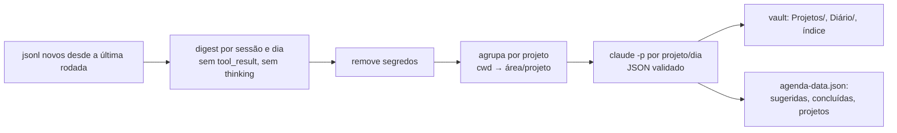

# Plano técnico — mapeamento pro Obsidian + checklist dirigido

## Decisões técnicas

| Tema | Decisão | Por quê |
|------|---------|---------|
| Linguagem | Node 24, sem dependências novas; testes com `node --test` | Mesmo runtime do app; nada a instalar |
| Onde vive | Pasta `sync/` neste repo; comando `node sync/run.js` | Um repo só pra app + sincronização |
| IA | `claude -p` com modelo leve (`haiku`; `sonnet` se a qualidade não bastar), sem ferramentas e sem gravar sessão | Escolha do Gabriel: qualidade em sessão técnica PT-BR, conteúdo Seazone não vai pra terceiro novo |
| Frequência | Agendador de Tarefas do Windows, diário às 06:00, "executar assim que possível se perdeu o horário" | Escolha do Gabriel; cobre PC desligado |
| Tarefa feita | Fecha sozinha com etiqueta "concluída pela sessão X" e botão desfazer | Escolha do Gabriel |
| Fonte da verdade | Tarefas e projetos no `agenda-data.json` do app; estado, histórico e "onde está" no vault | Decisão 7 da spec |

## Fatos que moldam o desenho

- Sessões: 130 arquivos `.jsonl` em `~/.claude/projects` (4,2 GB). Cada linha tem `type`,
  `timestamp`, `cwd`, `gitBranch`, `sessionId`, `entrypoint` (`cli` ou `claude-desktop`) e,
  em `user`/`assistant`, `message.content` com blocos `text`, `tool_use`, `tool_result`,
  `thinking`. O título vem em linhas `custom-title`. Só 9 sessões têm recap de `wrap_up`:
  não dá pra depender dele, precisa de resumo por IA.
- A sessão da Seazone tem 163 MB → leitura em stream e corte por tamanho antes da IA.
- App: entradas `{id, type: task|event|routine|goal, text, date, time, duration, priority 1–3}`;
  `server.js` só persiste `entries` e `reports` (descartaria `projects`) e mescla por `id` com o
  que chega por último vencendo — um navegador com cópia velha desfaria uma tarefa fechada
  pela rodada. Hoje o `agenda-data.json` tem 12 entradas, a última de 24/09.
- Vault não está em git → a rodada guarda backup do que sobrescreve.
- `seanotes_sync.py` já define o padrão de blocos `<!-- auto:X -->…<!-- /auto:X -->`; o
  escritor do vault segue a mesma regra.

## Fluxo da rodada diária

1. **Coleta** — lê só o que é novo (estado por arquivo: tamanho e último `timestamp`
   processado em `sync-state.json`, fora do git). Ignora `subagents/` e as próprias
   chamadas da rodada.
2. **Digest** (determinístico) — por sessão e dia: título, pasta, branch; falas do usuário
   (sem `<system-reminder>` e sem `isMeta`); textos do assistente; das ferramentas, só o
   rastro útil: arquivos editados/criados, `git commit` (1ª linha), PRs abertos e links de
   PR, itens de `update_plan` e recaps de `wrap_up`. Corte por tamanho com prioridade pro
   fim da sessão (onde está o estado mais recente).
3. **Segredos** — regex para chaves e tokens (`sk-`, `ghp_`, `xox`, `AKIA`, `Bearer`,
   `KEY/TOKEN/SECRET/PASS=`, hex/base64 longos) aplicada antes da IA e antes de gravar.
4. **Projeto** — `cwd` → projeto: remove `\.claude\worktrees\<x>`; regras em
   `sync/projects.config.json` (editável): `C:\Dev\Dev Seazone\<repo>` → Seazone;
   `C:\Dev\faculdade\…` → Faculdade; `C:\Dev\<nome>` → Pessoais; scratch, Temp e
   `C:\Users\gabri` → avulsas (só log do dia). Aliases (ex.: `Video-editor-broll` → Video editor).
5. **IA** — uma chamada por projeto com atividade no dia. Entra: estado atual do projeto
   (bloco `auto` da nota), tarefas abertas do projeto, digests do dia. Sai JSON com
   `estadoAtual`, `ondeEstaCadaCoisa`, `feitoNoDia`, `mudancas[{antes, depois}]`,
   `tarefasNovas[{titulo, contexto, prazo?}]`, `tarefasConcluidas[{id, evidencia}]`.
   JSON inválido → uma nova tentativa → senão o projeto é pulado e logado (nada é gravado
   pela metade). Digest grande demais → resumo por sessão primeiro, depois consolida.
6. **Vault** — grava só em `Projetos/`, `Diário/` e `Projetos.md`:
   - `Projetos/<Área>/<Projeto>.md`: blocos `auto:estado`, `auto:onde`, `auto:sessoes`,
     `auto:recente`; o que estiver fora dos blocos nunca é tocado.
   - `Diário/AAAA-MM-DD.md`: feito por projeto, mudanças ("X trocado por Y"), tarefas
     criadas e concluídas, sessões avulsas.
   - `Projetos.md`: tabela área / projeto / último dia / estado em uma linha.
   - Escrita atômica; antes de sobrescrever, cópia em `.sync-backup/<data>/` (pasta oculta
     pro Obsidian), mantida por 14 dias.
7. **App** — no `agenda-data.json` (caminho configurável):
   - tarefa nova: `type: task`, `source: sync`, `status: sugerida`, `projectId`, `context`,
     `date` (prazo, se houver), `fingerprint` (projeto + título normalizado), `createdAt`,
     `updatedAt`; não recria fingerprint já `descartada`, `feita` ou existente;
   - tarefa concluída: `status: feita`, `doneAuto: true`, `doneBy {sessão, evidência}`;
   - projeto: `projects[{id, nome, area, prioridade, goalId, prazo, ultimaAtividade, nota}]`.

## Ordem do checklist

Função pura `checklist.js` (carregada no navegador e testada no Node):

1. projeto com o prazo mais perto (menor `date` entre suas tarefas abertas, ou `prazo` do projeto);
2. prioridade — da meta ligada ao projeto (`goalId`), senão a do projeto (padrão média);
3. empate → projeto parado há mais tempo primeiro.

Dentro do projeto: prazo, depois confirmadas antes de sugeridas, depois mais antigas.
Descartadas e feitas saem da lista (feitas automáticas ficam visíveis no dia, com desfazer).

## Fatias

Cada fatia é testada (teste antes do código), roda de ponta a ponta e entra em PR próprio.

**F1 — Mapa do que existe (sem IA, sem gravar)**
`node sync/run.js --digest --desde 2026-09-01` gera, numa pasta de prévia, a lista de
projetos por área e o digest por dia. Testes: leitura de `.jsonl` (fixture sintética),
limpeza de `system-reminder`, cwd → projeto, regex de segredos, estado incremental.
Pronto quando: você revisa a lista de projetos e a classificação por área.

**F2 — Vault gerado pela IA**
`summarize.js` (com executor injetável; testes usam um falso), validação do JSON, `vault.js`
com blocos `auto`, backup e trava de escrita fora das 3 áreas. Primeiro em `--dry-run`
(grava em pasta de prévia), você revisa, depois a carga real de setembro e outubro.
Testes: texto manual preservado; mudança vira linha no diário; JSON inválido não grava nada.
Pronto quando: as notas de projeto e os diários estão no vault e você confere 3 projetos.

**F3 — Tarefas no app (dados)**
`agenda.js` cria sugeridas, deduplica por fingerprint, fecha com evidência; `server.js`
passa a guardar `projects` e `opens` e a mesclar por `updatedAt` (vence o mais novo);
`app.js` idem na mescla do navegador. Testes: descartada não volta; fechamento automático
marca `doneAuto`; cópia velha do navegador não desfaz fechamento.
Pronto quando: a rodada popula o `agenda-data.json` real e nada antigo se perde.

**F4 — Checklist na tela**
`checklist.js` (ordem testada) e painel no app: tarefas por projeto com contexto, botões
confirmar / descartar / feito / desfazer, seção "projetos novos" pra definir prioridade,
meta e prazo uma vez, registro de abertura do dia; `checklist.js` entra no `publicFiles`
do `server.js` e no `index.html` antes do `app.js`. Testes: as três regras de ordem;
contagem confirmadas × descartadas. Conferência no navegador.
Pronto quando: você abre o app e trabalha pelo checklist.

**F5 — Rodada automática**
`sync/install-task.ps1` registra a tarefa diária 06:00 (com recuperação de horário
perdido), trava contra execução dupla, processa todos os dias pendentes desde a última
rodada bem-sucedida e grava log em `sync/logs/`. Instalar a tarefa no Windows só com
seu OK. Teste: cálculo dos dias pendentes.
Pronto quando: duas manhãs seguidas o checklist aparece atualizado sem você rodar nada.

## Riscos a verificar cedo

- **Flags do `claude -p`** (início da F2): rodar sem ferramentas, sem plugins/hooks e com
  `--no-session-persistence`, pra não criar sessão que a própria rodada leria de novo.
  _Verificado em 21/10:_ `--bare` não serve (exige chave de API; o login é da assinatura).
  Combinação usada: `-p --model haiku --tools "" --no-session-persistence --strict-mcp-config
  --setting-sources local --disable-slash-commands --system-prompt … --output-format json
  --json-schema …`, prompt pelo stdin em UTF-8, rodando em `%TEMP%\agenda-sync-claude`.
  Nenhum `.jsonl` novo é criado; o `claude` cria só uma pasta vazia de memória para essa pasta
  de trabalho. Com registro real, cada resumo leva de 10 a 45 s.
  Os resumos ficam em cache em `sync-data/summaries/` (fora do git), com chave = versão do
  prompt + estado anterior + registro do dia; rodar de novo não chama a IA para o que não mudou.
- **Limite de uso** na carga inicial (~40 dias × alguns projetos): digest cortado, modelo
  leve, e carga inicial em lotes se precisar.
- **Tarefa agendada e credencial**: roda só com seu usuário logado, onde o login do Claude está.
- **Caminhos com espaço** ("New project", "Obsidian Vault", "Dev Seazone") nos testes.
- **Qualidade das sugestões**: a métrica de confirmadas × descartadas mostra na primeira
  semana se o prompt precisa de ajuste.

## Porte para a versão local do app (F4b)

F3 e F4 foram feitas sobre a versão do app que estava no GitHub. O app em uso é a versão de
setembro, que entrou na `main` no #7. Ela usa `planner-core.js`, `agenda-store.js` com
`revision`, mescla de 3 vias e a UI de `product-ui.js`. O porte leva o mesmo comportamento
pra ela:

- **Planejador** (`planner-core.js`): `schedule` ignora `source: "sync"`, então as tarefas da
  rodada não entram na semana nem no overlay. `normalize` e `merge` passam a cuidar de
  `projects` (3 vias por id, como as entradas) e de `opens` (união).
- **Servidor** (`server-runtime.js`): serve `checklist.js`. O contexto mandado pra IA (app e
  Telegram) fica sem as tarefas da rodada.
- **Rodada** (`sync/agenda.js`): só grava prazo `AAAA-MM-DD` válido, senão o `validate` do
  app recusaria toda gravação. Ao salvar, incrementa o `revision` e atualiza o `updatedAt`;
  sem isso o navegador não percebe a mudança.
- **Tela**: o painel "O que fazer agora" fica acima do calendário, com os 3 primeiros projetos
  abertos e o resto em "Mais N projetos". Lista de tarefas, prazos e contagens escondem as
  tarefas da rodada. Os cliques do checklist sincronizam sem mexer no `planningAt` (não
  replanejam o dia). `dataSnapshot` passa a mandar `projects` e `opens`.
- **`checklist.js`**: a prioridade da meta vem de `goals`, não mais de entradas `type: goal`.
- Sai o `agenda-merge.js`: a mescla de 3 vias da versão local substitui o "vence o mais novo".

Testes: `schedule` sem as tarefas da rodada; mescla de `projects` e `opens`; contexto da IA
sem elas; prazo inválido descartado; `revision` incrementado pela rodada. Conferência no
navegador.

## Fora deste plano

VM, Google Calendar, WhatsApp, mudanças no `seanotes_sync.py` e nas notas soltas do vault.
